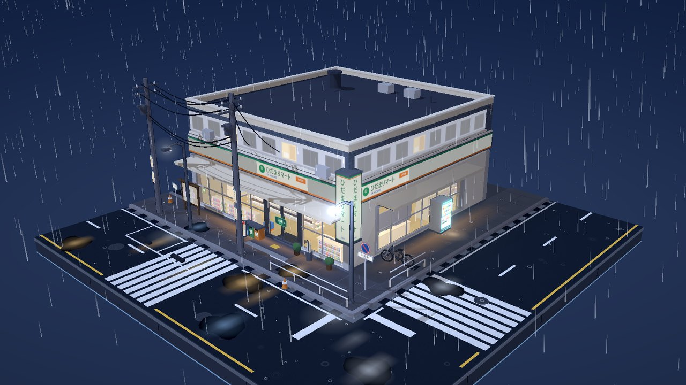
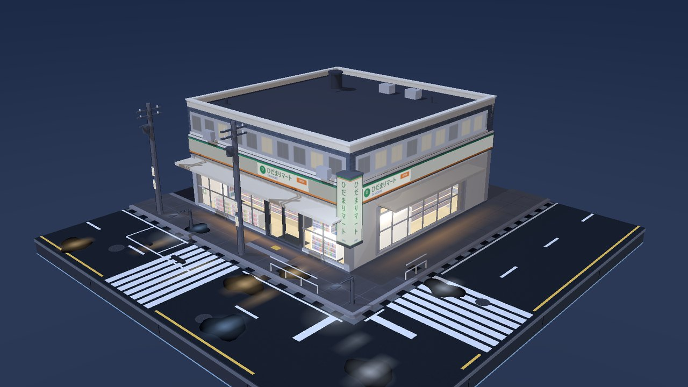
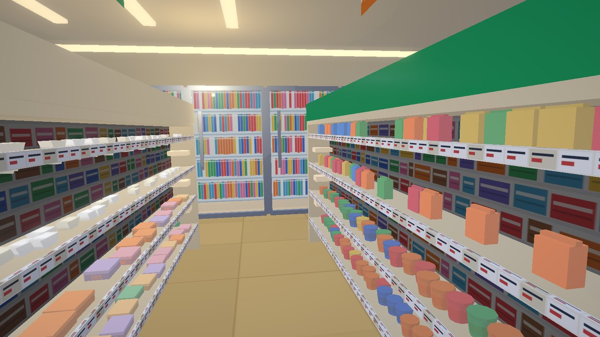
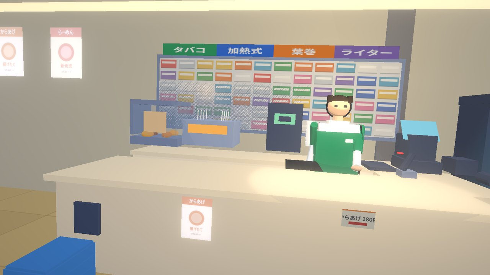
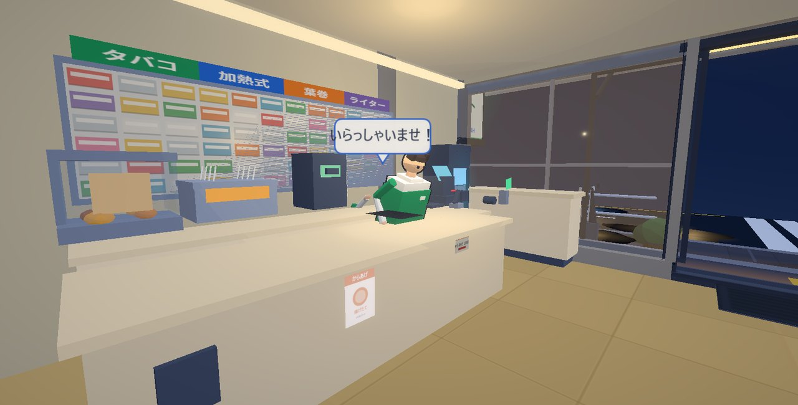

# 雨夜便利店街角 · 三渲二微缩模型

> 一座可以走进去的日式便利店街角微缩模型。三渲二（cel-shading）画风、雨夜霓虹、正方形可收藏底座，加载后自动播放「散件从地面往上组装」的入场动画。



**单文件 · 离线可用 · 零外部依赖** —— 双击 `index.html` 即可体验。

---

## 这是什么

一个纯前端的三维小场景：便利店位于正方形底座中心，双街交汇的街角，雨夜，霓虹，湿地面反光。你可以把它当可旋转观察的模型看，也可以点门上的按钮走进店里逛一圈，在收银台前和店员互动，然后转身离开。

画面里没有任何 UI 按钮或文字覆盖层——所有交互都发生在 3D 场景内部。

 

## 快速开始

双击仓库根目录的 `index.html`，浏览器打开即可。**不需要本地服务器、不联网、不加载任何图片或音频文件。**

托管到 GitHub Pages（Settings → Pages → main 分支 `/root`）后也可以直接用网址访问。

## 操作

### 俯瞰模式（默认）

| 操作 | 效果 |
|---|---|
| 左键拖拽 | 旋转视角 |
| 滚轮 | 缩放（限制 18–62，防止穿进模型）|
| 点击门上的绿色「入店 / ENTER」 | 门滑开，镜头落到门口再走进店内 |
| `R` | 重播入场组装动画 |
| `M` | 静音 / 取消静音 |

### 店内参观模式

| 操作 | 效果 |
|---|---|
| 轻点（不拖拽）| 前进约 2m，视线自动顺着路径转向 |
| **按住左键约 0.4s** | 连续前进（约 4.7m/s），松手即停 |
| 左键拖拽 | 原地转头看（下次前进时自动回正）|
| 滚轮 | 缩放画面（视场角 40°–92°，进店默认 66° 广角）|
| 点击店员 / POS / 支付终端 | 触发交互，头顶浮出 3D 对话气泡 |
| 走到收银台 | **自动停下并面向店员**，店员鞠躬招呼 |
| 在收银台点空白处 | **转身离开**，沿路径走出店外并自动退出 |
| `Esc` | 立刻退出参观 |

 

## 场景内容

- **建筑**：便利店主体（玻璃幕墙、自动门、雨棚灯带、主招牌带、转角竖灯箱、二层住宅立面、屋顶设备）
- **店内**：3 排双面货架（1106 个分品类实例商品：おにぎり三棱柱、弁当扁盒、カップ麺、ペットボトル、缶、スナック袋、雑誌，另有价签条、売切 POP、6 块分区吊牌）、5 台饮料冷柜、杂志架、收银台（POS 斜屏、小票打印机、扫码枪、顾客侧支付终端、72 格烟架、热食柜、咖啡机、关东煮锅）、**一名店员**（低模三渲二 + 描边 + 呼吸与头部微动）、后墙日用品货架、ATM、天花灯槽
- **街道**：双街 + 转角人行道 + 路缘石 + 排水沟格栅 + 井盖 + 停车位 + 两处斑马线 + 积水与霓虹倒影 + 小巷
- **道具**：自动贩卖机 ×2、自行车、雨伞架、分类垃圾桶、街角护栏、路灯 ×2、电线杆 ×2 + 悬链电线 + 入户线、路牌、公告栏、空调外机、周转箱、盆栽、交通锥
- **氛围**：天空穹顶渐变、月光主光 + 阴影、2000 条雨丝（着色器循环）、地面溅射、积水涟漪、蒸汽薄雾、漂浮微粒、bloom + 收尾调色

## 声音

雨声是 **Web Audio 现场合成**的，仓库里没有任何音频文件：3 秒立体声粉噪（左右去相关）→ 高通 240Hz → 低通 2600Hz → 0.085Hz 阵风 LFO。

| 位置 | 雨声增益 | 低通 | 说明 |
|---|---|---|---|
| 俯瞰全景（~40m）| 0.338 | 2600Hz | 完整雨声 |
| 俯瞰拉近（~15m）| 0.194 | 2600Hz | 开始被雨棚遮挡 |
| 贴近店门（~10m）| 0.157 | 2600Hz | 屋檐下的雨声 |
| 店内收银台 | 0.050 | 769Hz | 变成室外闷响 + 淡入冷柜低鸣 |

> 浏览器策略要求先有一次交互才能出声，首次点击画面即开始。

## 技术实现

- **three.js r160**（ESM）+ **esbuild** 打包成 IIFE，内联进单个 HTML（约 800KB，离线可用）
- **三渲二**：`MeshToonMaterial` + 3 阶 gradientMap；主要剪影用反向外壳描边（自定义 `ShaderMaterial` 沿法线外扩）
- **程序化贴图**：全部用 canvas 2D 生成——沥青、地砖、招牌字、商品排面、贩卖机面板、海报、公告栏、涟漪、灯晕……仓库里没有一张图片资源
- **渲染**：`UnrealBloomPass`(0.42/0.55/0.86) + 自定义调色 Pass（提饱和、冷暗部/暖高光、暗角）+ `OutputPass`
- **入场动画**：每个装配单元用 `userData.asm` 标注，`timeline.js` 统一编排 6 种模式（rise / drop / pop / grow / wipe / fade），7 秒完成，播完精确还原 transform
- **参观模式**：31 点 Catmull-Rom（centripetal）路径 + SmoothDamp 位移（无过冲）+ 四元数阻尼转向；收银台靠站由「最近的 look 点 ↔ 店员世界坐标」自动对齐
- **交互**：射线检测 + 46px 屏幕空间容错；3D 气泡是自动朝向镜头的 `Sprite`
- **音频**：Web Audio 噪声合成 + `setTargetAtTime` 平滑参数（避免爆音）

## 性能（1600×900 实测）

- `meshes=351`（draw call 代理）、`tris≈107k`、实例化 3344
- 动态元素（雨 / 溅射 / 涟漪 / 雾 / 微粒）各 1 个 draw call；入场动画零 draw call 增量
- SwiftShader 软渲染下仍保持 53–57 fps

## 目录结构

```
index.html                 交付物：打包好的单文件，双击即看
src/main.js                渲染器 / 相机 / 控制器 / bloom / 调色 / 主循环 / 参观状态机 / 雨声
src/core/palette.js        调色板
src/core/mats.js           三渲二材质工厂（cel / interior / lit / glow / glass / outline）
src/core/tex.js            程序化贴图（沥青、地砖、招牌字、商品、海报、涟漪…）
src/core/utils.js          几何与合批工具（box / cyl / merge / inst / wire / mark）
src/world/street.js        底座 + 地面层（街道、斑马线、排水沟、积水、小巷）
src/world/store.js         便利店外壳 + 店内（货架、冷柜、收银台、店员、交互动画）
src/world/props.js         街景道具
src/world/atmosphere.js    天空 / 灯光 / 雨 / 溅射 / 涟漪 / 雾
src/world/timeline.js      入场组装时间线
CONTRACTS.md               坐标布局与模块契约（并行开发用的接口文档）
docs/                      README 截图
```

## 本地开发

```bash
npm install                # three + esbuild
node build.mjs --dev       # 打包到 dist/index.html（不压缩）
node build.mjs             # 打包到 dist/index.html（压缩）
cp dist/index.html index.html   # 同步交付文件
node shot.mjs out/a.png '?t=9'            # 无头截图：终态
node shot.mjs out/b.png '?t=3.5'          # 入场动画中段
node shot.mjs out/c.png '?t=9&only=store' # 只渲染某个模块（排查用）
```

URL 调试参数（不影响成品）：`?t=<秒>` 时间线定位；`inside=1&s=0.8` 直接跳到参观路径某处；`at=counter` 停到收银台；`only=` / `hide=` 模块隔离；`cam=x,y,z` / `tgt=x,y,z` 覆盖机位。

## 已知取舍

- 湿地面反光是**伪造**的（深色高光水洼 + 加法混合倒影条），没有用实时反射——为了帧率。
- 店内亮度靠自发光与灯槽，不用实时 GI；点光强度按像素测量校准（更高会直接爆白）。
- 商品与店员是刻意的低模三渲二风格，不是写实资产。
- 雨在入场动画接近完成时才落下（order 0.88），是刻意的编排。

## 许可

未指定开源许可。如需商用或再分发，请先联系作者。
